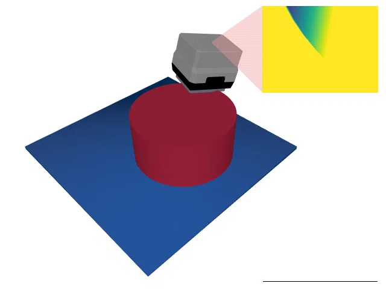

# PrimitiveShapes

<p align="center"></p>

This environment is part of the tactile classification environments.
Refer to the [tactile classification environments overview](TactileClassificationEnv.md) for a general description of these environments.

|                              |                                                                         |
|------------------------------|-------------------------------------------------------------------------|
| **Environment ID**           | PrimitiveShapes-v0                                                      |
| **Dataset**                  | [PrimitiveShapes](datasets.md#primitiveshapes) (procedurally generated) |
| **Number of classes**        | 4                                                                       |
| **Step limit**               | 32                                                                      |
| **Sensor rotation**          | enabled                                                                 |
| **Object pose perturbation** | enabled                                                                 |

## Description

In the _PrimitiveShapes_ environment, the agent must tell apart four geometric primitives: cylinders, cuboids, triangular prisms, and half cylinders.
The objects are large relative to the platform, so finding them is easy.
Instead, the challenge lies in telling the shapes apart: since the dimensions of every object are drawn at random, the classes overlap in size and only differ in their outline.
A touch on a flat top face looks the same for every class, so the agent has to seek out the edges and sides of the object, and with sensor rotation enabled, it can tilt the sensor to touch them.

The objects are not stored anywhere but generated procedurally on the fly: each of the 300,000 objects is derived deterministically from its index with a stable pseudo random number generator (see the [dataset description](datasets.md#primitiveshapes)).
As the dimensions are drawn from a continuous distribution, the agent cannot memorize the objects, and there is no separate test split.

## Example Usage

```python
import ap_gym

env = ap_gym.make("PrimitiveShapes-v0")

# Or for the vectorized version with 4 environments:
envs = ap_gym.make_vec("PrimitiveShapes-v0", num_envs=4)
```

## Version History

- `v0`: Initial release.

## Variants

| Environment ID              | Description                                                                                                        | Preview                                                                                               |
|-----------------------------|--------------------------------------------------------------------------------------------------------------------|-------------------------------------------------------------------------------------------------------|
| PrimitiveShapes-DR-v0       | Same as PrimitiveShapes-v0 but with [domain randomization](TactilePerceptionConfig.md#sensor-noise) enabled.       |              |
| PrimitiveShapes-Depth-v0    | Uses a depth image instead of rendering tactile images.                                                            |        |
| PrimitiveShapes-Depth-DR-v0 | Same as PrimitiveShapes-Depth-v0 but with [domain randomization](TactilePerceptionConfig.md#sensor-noise) enabled. |  |
