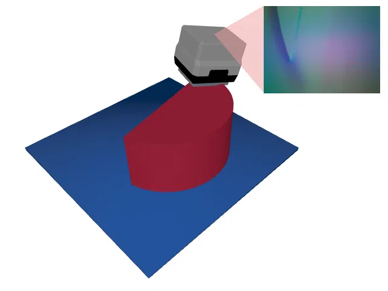
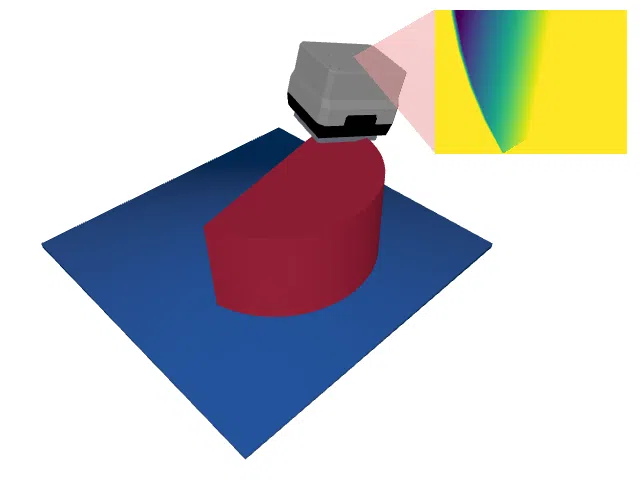

# PrimitiveShapesVolume

<p align="center"></p>

This environment is part of the tactile regression environments.
Refer to the [tactile regression environments overview](TactileRegressionEnv.md) for a general description of these environments.

|                              |                                                                         |
|------------------------------|-------------------------------------------------------------------------|
| **Environment ID**           | PrimitiveShapesVolume-v0                                                |
| **Dataset**                  | [PrimitiveShapes](datasets.md#primitiveshapes) (procedurally generated) |
| **Prediction Dimensions**    | 1                                                                       |
| **Step limit**               | 32                                                                      |
| **Sensor rotation**          | enabled                                                                 |
| **Object pose perturbation** | enabled                                                                 |

## Description

In the PrimitiveShapesVolume environment, the agent's objective is to estimate the volume of a geometric primitive: a cylinder, a cuboid, a triangular prism, or a half cylinder with randomly drawn dimensions.
Unlike in the ABCVolume environment, the objects are simple, so a few well-placed touches suffice to measure them: the agent has to find out the shape of the object, measure its footprint, and determine its height, for which, with sensor rotation enabled, it can tilt the sensor to touch the sides of the object.
Since the volume is known in closed form for every primitive, the prediction targets are exact.

The objects are generated procedurally on the fly (see the [dataset description](datasets.md#primitiveshapes)), so the agent cannot memorize them.

## Prediction Target Space

The prediction target is a 1-element `np.ndarray` containing the volume of the object.
We normalize the object volumes to have a mean of 0 and a standard deviation of 1 across the training set; the test split uses the same normalization parameters.
In case of the PrimitiveShapes dataset, the normalization parameters are as follows:

- Mean: 75.852 cm $^3$
- Standard Deviation: 20.232 cm $^3$

The volumes range from 38.1 cm $^3$ to 167.3 cm $^3$.
These values are computed from the closed-form volumes of the training objects when the environment is first created and cached for future runs.

## Loss Function

The loss (and hence the negative reward) is the normalized Huber loss of the normalized volume described in [ABCVolume](ABCVolume.md#loss-function).

## Example Usage

```python
import ap_gym

env = ap_gym.make("PrimitiveShapesVolume-v0")

# Or for the vectorized version with 4 environments:
envs = ap_gym.make_vec("PrimitiveShapesVolume-v0", num_envs=4)
```

## Version History

- `v0`: Initial release.

## Variants

| Environment ID                         | Description                                                                                                                                                                          | Preview                                                                                                                     |
|----------------------------------------|--------------------------------------------------------------------------------------------------------------------------------------------------------------------------------------|-----------------------------------------------------------------------------------------------------------------------------|
| PrimitiveShapesVolume-train-v0         | Alias for PrimitiveShapesVolume-v0.                                                                                                                                                  |                              |
| PrimitiveShapesVolume-DR-v0            | Same as PrimitiveShapesVolume-v0 but with [domain randomization](TactilePerceptionConfig.md#sensor-noise) enabled. PrimitiveShapesVolume-DR-train-v0 is an alias for it.             |                        |
| PrimitiveShapesVolume-test-v0          | Uses the test split of _PrimitiveShapes_ instead of the train split.                                                                                                                 |                    |
| PrimitiveShapesVolume-DR-test-v0       | Same as PrimitiveShapesVolume-test-v0 but with [domain randomization](TactilePerceptionConfig.md#sensor-noise) enabled.                                                              |              |
| PrimitiveShapesVolume-Depth-train-v0   | Uses a depth image instead of rendering tactile images.                                                                                                                              |                  |
| PrimitiveShapesVolume-Depth-DR-v0      | Same as PrimitiveShapesVolume-Depth-v0 but with [domain randomization](TactilePerceptionConfig.md#sensor-noise) enabled. PrimitiveShapesVolume-Depth-DR-train-v0 is an alias for it. |            |
| PrimitiveShapesVolume-Depth-test-v0    | Same as PrimitiveShapesVolume-Depth-train-v0 but uses the test split of _PrimitiveShapes_ instead of the train split.                                                                |        |
| PrimitiveShapesVolume-Depth-DR-test-v0 | Same as PrimitiveShapesVolume-Depth-test-v0 but with [domain randomization](TactilePerceptionConfig.md#sensor-noise) enabled.                                                        |  |
